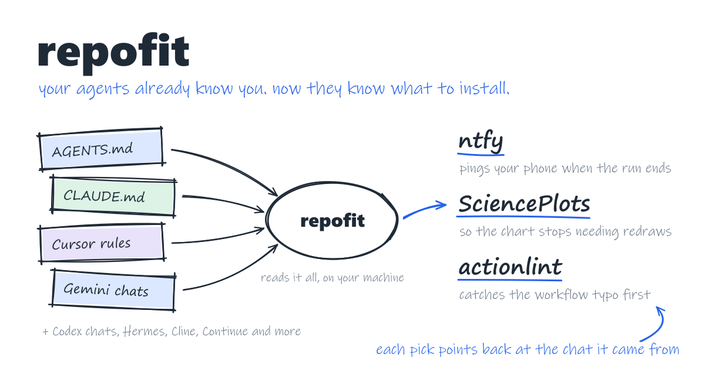
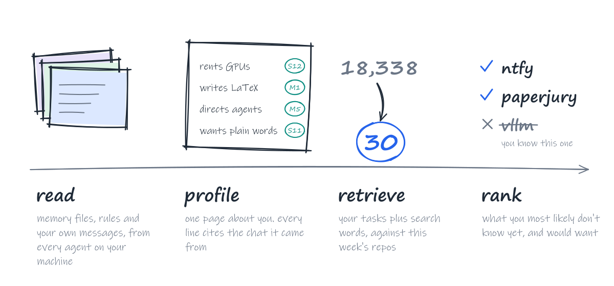

<picture>
  <source media="(prefers-color-scheme: dark)" srcset="https://raw.githubusercontent.com/pth2002/repofit/main/assets/hero-dark.svg" />
  
</picture>

<p align="center">
  <a href="https://github.com/pth2002/repofit/actions/workflows/test.yml"></a>
  
  
  
  <a href="https://github.com/pth2002/repofit/blob/main/LICENSE"></a>
</p>

**Stop scrolling trending. Ask the agent that has watched you work.**

Every week another wave of repositories hits ten thousand stars, and every "tools you should try" list is
written for everyone at once. Meanwhile your coding agents have been taking notes on you for months: what you
build, what keeps breaking, what you complained about at 2 a.m. repofit reads those notes on your own
machine, from Claude Code, Codex, Cursor and a dozen more, and turns them into picks you have not heard of
and will actually use. Every pick shows you the moment in your own history that earned it.

https://github.com/user-attachments/assets/c7ac0bcf-74ed-4a09-9295-b6d06e6d67c1

## Install

```bash
pipx install repofit
```

Then point the agents you use at `repofit mcp`. Most of them read the same MCP config:

```json
{ "mcpServers": { "repofit": { "command": "repofit", "args": ["mcp"] } } }
```

That line goes in `~/.cursor/mcp.json` for Cursor, `~/.gemini/settings.json` for Gemini CLI,
`~/.qwen/settings.json` for Qwen Code, and the MCP settings of Cline, Windsurf or Claude Desktop. Codex reads
TOML, and Claude Code adds servers from the command line:

```toml
# ~/.codex/config.toml
[mcp_servers.repofit]
command = "repofit"
args = ["mcp"]
```

```bash
claude mcp add repofit -- repofit mcp
```

repofit runs inside your agent, so your agent's own model does the thinking: no API key, no account, nothing
to host. To skip the install step, use [uv](https://docs.astral.sh/uv/) and make the command `uvx repofit mcp`.

## Just ask

Open a new session in any agent you connected and talk to it like a colleague who has read your history:

- "Use repofit to recommend some GitHub projects for me."
- "Does github.com/owner/name fit me?"
- "Is there a good tool for turning PDFs into Markdown?"
- "Which of my installed skills do I never use?"

The agent shows you the picks in the chat, and the same list stays one command away:


<sub>The picks come from a sample history. The text is exactly what the CLI prints.</sub>

Every pick has a receipt. No "because you starred X": the `seen in` line points at the session where the need
showed up and quotes what you said. If repofit cannot point at your history, it does not make the pick.

The list at the bottom matters more than it sounds. Every skill and MCP server you installed and forgot still
costs context on every single request, and repofit names the ones none of your sessions ever called.

## How it picks

<picture>
  <source media="(prefers-color-scheme: dark)" srcset="https://raw.githubusercontent.com/pth2002/repofit/main/assets/steps-dark.svg" />
  
</picture>

Each agent stores its history differently, and the formats change every few months, so repofit ships one
adapter per agent. The profile is written from a redacted, numbered evidence pack, and any claim that cites
evidence that does not exist is thrown out by the code, not left to the model's good manners. Retrieval runs
one query per task you actually do, with project names and search phrases the model adds, so it finds the
library a task depends on even when you never typed its name. The ranker is told to skip the household names
you already know. The candidate pool is rebuilt every Monday from the GitHub API: active repositories above
3,000 stars, new ones above 1,000, the agent ecosystem above 300, plus GitHub trending.

## Your history stays yours

- Everything runs on your machine. repofit reads the files your agents already keep and writes its own to
  `~/.repofit`.
- You choose the depth: installed tools only, plus memory and instruction files (the default), or plus your
  own messages and tool calls.
- Before any model sees a line, API keys, tokens, passwords, emails, phone numbers and random-looking strings
  (yes, including the password you once pasted after `ssh`) are stripped, and your home folder becomes `~`.
- With MCP, the text goes to the model your agent already uses. From the command line it goes only to the
  provider you name, after you confirm.
- Your notes and other people's READMEs can hide instructions. repofit hands everything over as data, and the
  agent is told never to follow what it finds inside.

## Supported agents

| Agent | Sessions | Memory and instructions | Installed tools |
|---|---|---|---|
| Claude Code | yes | `CLAUDE.md`, project memory | skills, plugins, MCP servers |
| Codex | yes, CLI and desktop | `AGENTS.md`, `memories/` | skills, plugins, MCP servers |
| Cursor | yes | user rules, pending memories | MCP servers, extensions |
| Hermes Agent | yes | `USER.md`, `MEMORY.md` | skills, MCP servers |
| Gemini CLI, Qwen Code | yes | `GEMINI.md`, `QWEN.md` | MCP servers, extensions |
| Cline, Roo Code, Kilo Code | yes | `.clinerules` | MCP servers |
| Continue | yes | `rules/` | MCP servers |
| VS Code Copilot | yes | `copilot-instructions.md` | MCP servers, extensions |
| Kimi CLI, Aider | yes | | |
| OpenCode | counted | `AGENTS.md` | MCP servers |
| Windsurf, Claude Desktop, WorkBuddy, Trae | no local sessions | memories where present | MCP servers |

Project instruction files (`AGENTS.md`, `CLAUDE.md`, `.cursorrules` and friends) are read too. Run
`repofit scan` to see what it finds on your machine. If your agent hides its data somewhere else, open an
issue with the path and it gets an adapter.

<details>
<summary>Command line, no agent needed</summary>

Install with `pipx install repofit`, or put `uvx` in front of each command.

```bash
repofit scan                                    # which agents are installed and what each one stores
repofit profile build --level L2 --provider deepseek
repofit recommend --provider deepseek --lang zh
```

Providers: `deepseek`, `openai`, `ollama`, `anthropic`, or any OpenAI-compatible endpoint with
`--provider compatible --base-url ... --model ...`. Keys come from `DEEPSEEK_API_KEY`, `OPENAI_API_KEY` or
`ANTHROPIC_API_KEY`, and repofit shows how much text it will send before it sends anything.

No provider at all? Each model step prints a prompt to paste into any chat and imports the answer:

```bash
repofit profile prompt --level L2 > prompt.md   # then: repofit profile apply answer.json
repofit profile expand --prompt                 # then: repofit profile expand --apply answer.json
repofit recommend --prompt --lang en            # then: repofit recommend --apply answer.json
repofit recommend --no-llm                      # keyword retrieval only, nothing leaves your machine
```

</details>

## Development

```bash
git clone https://github.com/pth2002/repofit && cd repofit
python -m pip install -e . pytest
python -m pytest
repofit index build      # rebuild the candidate pool yourself; needs a GitHub token
```

## License

MIT

<!-- mcp-name: io.github.pth2002/repofit -->
