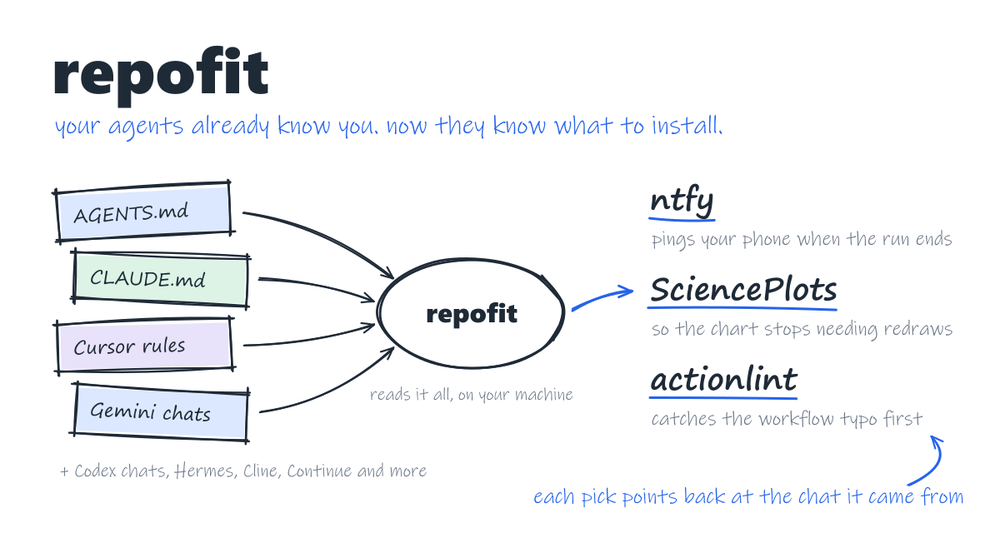
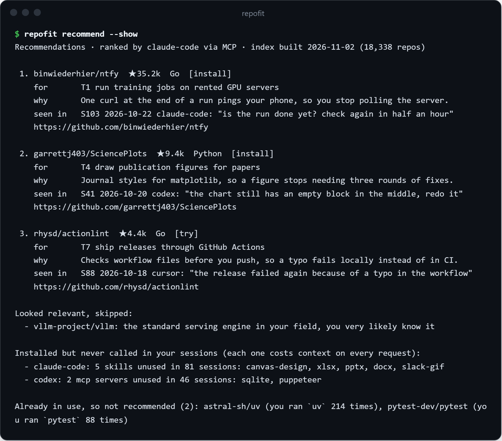
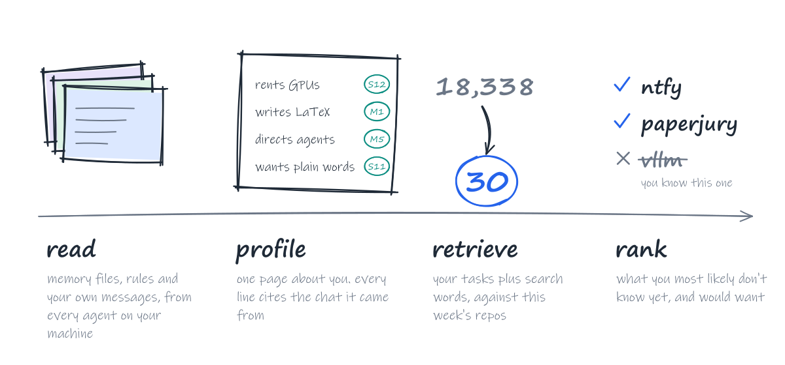

<picture>
  <source media="(prefers-color-scheme: dark)" srcset="https://raw.githubusercontent.com/pth2002/repofit/main/assets/hero-dark.svg" />
  
</picture>

<p align="center">
  <a href="https://github.com/pth2002/repofit/actions/workflows/test.yml"></a>
  
  
  
  <a href="https://github.com/pth2002/repofit/blob/main/LICENSE"></a>
</p>

<p align="center"><a href="https://github.com/pth2002/repofit/blob/main/README.md">English</a> · <b>简体中文</b></p>

**别再刷 Trending 了，去问那个天天看着你干活的 agent。**

GitHub 上每周都有一批新项目冲上上万颗星，各种“值得一试的工具”清单又是写给所有人看的。可你的编程助手已经默默记了你好几个月：你在做什么，什么老是出问题，凌晨两点抱怨过什么。repofit 在你自己的电脑上读这些记录，覆盖 Claude Code、Codex、Cursor 等十几种 agent，然后挑出你还没听说过、但真会用上的项目。每条推荐都会告诉你，它来自你历史里的哪一刻。

## 一行命令先试试

```bash
uvx repofit unused
```

不用安装，不用注册，不用 API key，也不用模型。它读取各家 agent 本来就存着的会话记录，列出你装了却从没调用过的 MCP 服务器和 skill。它们每次请求都还在占用上下文。没装 [uv](https://docs.astral.sh/uv/) 的话，用 `pipx run repofit unused`。

```text
Read 17 sessions from Claude Code, Codex, Gemini CLI. Nothing left this machine.

7 of 9 installed MCP servers and skills were never called:

  Claude Code · 12 sessions
    MCP server   sqlite
    skills       canvas-design, docx, pptx
  Codex · 4 sessions
    MCP server   puppeteer
    skills       slack-gif-creator, xlsx

Each one still costs context on every request. Remove the ones you do not need.

Not checked: 1 tool in Gemini CLI. Its logs do not say which server or skill each call went
to, or hold no sessions yet.

Want GitHub projects picked from the same history? Connect `repofit mcp` to your agent:
https://github.com/pth2002/repofit
```

<sub>样例历史上的输出。</sub>

https://github.com/user-attachments/assets/c7ac0bcf-74ed-4a09-9295-b6d06e6d67c1

## 安装

```bash
pipx install repofit
```

然后让你用的 agent 连上 `repofit mcp`。大多数 agent 认同一种 MCP 配置：

```json
{ "mcpServers": { "repofit": { "command": "repofit", "args": ["mcp"] } } }
```

这行配置放在哪里：Cursor 是 `~/.cursor/mcp.json`，Gemini CLI 是 `~/.gemini/settings.json`，Qwen Code 是 `~/.qwen/settings.json`，Cline、Windsurf 和 Claude Desktop 写在各自的 MCP 设置里。Codex 用 TOML，Claude Code 用命令行添加：

```toml
# ~/.codex/config.toml
[mcp_servers.repofit]
command = "repofit"
args = ["mcp"]
```

```bash
claude mcp add repofit -- repofit mcp
```

repofit 跑在你的 agent 里面，推理用的是 agent 自己的模型：不用 API key，不用注册账号，也没有服务要部署。想省掉安装这一步，可以用 [uv](https://docs.astral.sh/uv/)，把命令写成 `uvx repofit mcp`。

## 直接问

在接好的任意一个 agent 里新开会话，像跟一个看过你全部记录的同事说话那样问它：

- “用 repofit 给我推荐一些 GitHub 项目。”
- “github.com/owner/name 适合我吗？”
- “有没有好用的 PDF 转 Markdown 工具？”
- “我装的 skill 里，哪些从来没用过？”

agent 会直接在对话里列出推荐，同一份清单在命令行里也随时能看：



<sub>推荐来自一份样例历史，文字就是命令行的原样输出。</sub>

每条推荐都有出处。不是“因为你给 X 点过星”：`seen in` 那一行指向需求出现的那次会话，并引用你当时说的话。要是在你的历史里找不到依据，repofit 就不推荐。

最下面那一栏比看上去更有用。你装了又忘掉的每一个 skill 和 MCP 服务器，每次请求都还在占用上下文。repofit 会列出哪些从没被任何一次会话调用过。

## 它是怎么挑的

<picture>
  <source media="(prefers-color-scheme: dark)" srcset="https://raw.githubusercontent.com/pth2002/repofit/main/assets/steps-dark.svg" />
  
</picture>

每家 agent 存历史的方式都不一样，格式几个月就变一次，所以 repofit 给每家 agent 各写了一个适配器。画像根据一份脱敏、编了号的证据包写成，哪条结论引用了不存在的证据，就会被代码直接删掉，不靠模型自觉。检索时，你实际在做的每项任务各发一次查询，再加上模型补充的项目名和搜索词，所以就算你从没打过某个库的名字，它也能找到任务背后依赖的那个库。排序时，模型会被要求跳过你肯定早就知道的大热门。候选库每周一从 GitHub API 重建：3,000 星以上的活跃仓库、1,000 星以上的新仓库、300 星以上的 agent 生态项目，再加上 GitHub Trending。

## 你的记录只属于你

- 所有处理都在你的电脑上完成。repofit 只读各家 agent 本来就存着的文件，自己的文件写在 `~/.repofit`。
- 读多深由你决定：只看已安装的工具；再加上记忆和指令文件（默认）；或者再加上你自己的消息和工具调用。
- 在任何模型看到之前，API key、token、密码、邮箱、手机号和看起来像随机串的字符串都会被去掉（没错，包括你某次在 `ssh` 后面顺手贴的密码），你的用户目录会被替换成 `~`。
- 用 MCP 时，文本只发给你的 agent 本来就在用的模型。用命令行时，只发给你指定的模型服务，而且发送前会先让你确认。
- 你的笔记和别人的 README 里都可能藏着指令。repofit 把所有内容都作为数据交给 agent，并告诉 agent 永远不要执行里面的指令。

## 支持的 agent

| Agent | 会话 | 记忆与指令 | 已安装的工具 |
|---|---|---|---|
| Claude Code | 支持 | `CLAUDE.md`、项目记忆 | skill、插件、MCP 服务器 |
| Codex | 支持，CLI 和桌面版 | `AGENTS.md`、`memories/` | skill、插件、MCP 服务器 |
| Cursor | 支持 | 用户规则、待确认的记忆 | MCP 服务器、扩展 |
| Hermes Agent | 支持 | `USER.md`、`MEMORY.md` | skill、MCP 服务器 |
| Gemini CLI、Qwen Code | 支持 | `GEMINI.md`、`QWEN.md` | MCP 服务器、扩展 |
| Cline、Roo Code、Kilo Code | 支持 | `.clinerules` | MCP 服务器 |
| Continue | 支持 | `rules/` | MCP 服务器 |
| VS Code Copilot | 支持 | `copilot-instructions.md` | MCP 服务器、扩展 |
| Kimi CLI、Aider | 支持 | | |
| OpenCode | 只统计数量 | `AGENTS.md` | MCP 服务器 |
| Windsurf、Claude Desktop、WorkBuddy、Trae | 本地没有会话 | 有记忆时读取 | MCP 服务器 |

项目里的指令文件（`AGENTS.md`、`CLAUDE.md`、`.cursorrules` 等）也会读取。运行 `repofit scan` 可以看到它在你电脑上找到了什么。如果你的 agent 把数据存在别的地方，提一个 issue 写上路径，就会加上对应的适配器。

<details>
<summary>命令行用法，不需要 agent</summary>

用 `pipx install repofit` 安装，或者在每条命令前加上 `uvx`。

```bash
repofit unused                                  # 装了却从没被调用过的 MCP 服务器和 skill
repofit scan                                    # 装了哪些 agent，每个存了什么
repofit profile build --level L2 --provider deepseek
repofit recommend --provider deepseek --lang zh
```

可选的模型服务：`deepseek`、`openai`、`ollama`、`anthropic`，或者任何兼容 OpenAI 接口的服务，用 `--provider compatible --base-url ... --model ...`。密钥从 `DEEPSEEK_API_KEY`、`OPENAI_API_KEY` 或 `ANTHROPIC_API_KEY` 读取，发送前 repofit 会先告诉你要发多少文本。

完全不用模型服务也行。每个需要模型的步骤都会打印一段提示词，你贴到任何聊天窗口里，再把回答导入：

```bash
repofit profile prompt --level L2 > prompt.md   # 然后：repofit profile apply answer.json
repofit profile expand --prompt                 # 然后：repofit profile expand --apply answer.json
repofit recommend --prompt --lang zh            # 然后：repofit recommend --apply answer.json
repofit recommend --no-llm                      # 只做关键词检索，什么都不离开你的电脑
```

</details>

## 开发

```bash
git clone https://github.com/pth2002/repofit && cd repofit
python -m pip install -e . pytest
python -m pytest
repofit index build      # 自己重建候选库，需要 GitHub token
```

## 许可证

MIT
